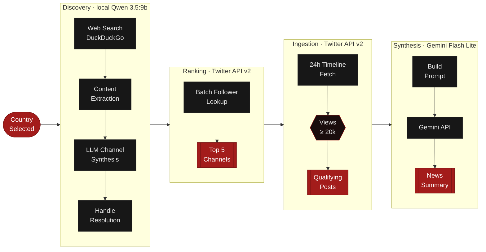

# News Summary Engine

A fully automated pipeline that discovers the most-followed national news accounts for any country, ingests their posts from the past 24 hours, filters by minimum impression count, and synthesises a plain-English news summary using Google Gemini — all from a single country selector.

---

## Architecture



---

## Stack

| Layer                                                | Technology                                           | Role                                                        |
| ---------------------------------------------------- | ---------------------------------------------------- | ----------------------------------------------------------- |
| **UI**                                         | Streamlit 1.38+                                      | Web interface                                               |
| **Channel Discovery — Search**                | DuckDuckGo Search (`ddgs`)                         | Web queries for top news channels and Twitter handles       |
| **Channel Discovery — Search (optional)**     | SearXNG                                              | Self-hosted search fallback                                 |
| **Channel Discovery — Extraction**            | Trafilatura                                          | Fast static page content extraction                         |
| **Channel Discovery — Extraction (fallback)** | Crawl4AI + Playwright                                | JavaScript-rendered page extraction                         |
| **Channel Discovery — LLM**                   | Ollama · qwen3.5:9b                                 | Local LLM — parses evidence into structured channel table  |
| **Audience Ranking**                           | Twitter / X API v2 — `GET /2/users/by`            | Batch follower count lookup (up to 100 handles per request) |
| **Post Ingestion**                             | Twitter / X API v2 — `GET /2/users/:id/tweets`    | 24-hour timeline fetch with impression filter               |
| **Summary Synthesis**                          | Google Gemini Flash Lite (`gemini-3.5-flash-lite`) | Factual plain-English news summary generation               |
| **Data**                                       | World Bank country list (217 countries, CSV)         | Country selector catalog                                    |

---

## Prerequisites

| Requirement                   | Version          | Notes                              |
| ----------------------------- | ---------------- | ---------------------------------- |
| Python                        | 3.11 or later    |                                    |
| [Ollama](https://ollama.com)   | latest           | must be running locally            |
| Qwen 3.5:9b model             | —               | `ollama pull qwen3.5:9b`         |
| Twitter / X Developer account | API v2 Free tier | Bearer token required              |
| Google Gemini API key         | —               | Free tier sufficient               |
| SearXNG *(optional)*        | —               | Falls back to DuckDuckGo if absent |

---

## Installation

```bash
# 1. Clone the repository
git clone <repo-url>
cd News

# 2. Create and activate a virtual environment
python3 -m venv .venv
source .venv/bin/activate        # Windows: .venv\Scripts\activate

# 3. Install dependencies
pip install -r requirements.txt

# 4. Copy the environment template and fill in your credentials
cp .env.example .env

# 5. Pull the local LLM model
ollama pull qwen3.5:9b
```

---

## Environment Variables

Copy `.env.example` to `.env` and populate every value before running.

| Variable                  | Required | Description                                                         |
| ------------------------- | -------- | ------------------------------------------------------------------- |
| `TWITTER_BEARER_TOKEN`  | Yes      | Twitter API v2 Bearer token for user metrics and timeline endpoints |
| `TWITTER_API_KEY`       | Yes      | Twitter API key (OAuth 1.0a consumer key)                           |
| `TWITTER_API_SECRET`    | Yes      | Twitter API secret (OAuth 1.0a consumer secret)                     |
| `GEMINI_API_KEY`        | Yes      | Google Gemini API key for summary synthesis                         |
| `OLLAMA_BASE_URL`       | No       | Ollama server URL — defaults to `http://localhost:11434`         |
| `OLLAMA_MODEL`          | No       | Ollama model name — defaults to `qwen3.5:9b`                     |
| `GEMINI_MODEL`          | No       | Gemini model — defaults to `gemini-3.5-flash-lite`               |
| `DEFAULT_SEARCH_ENGINE` | No       | `ddgs` (DuckDuckGo) or `searxng` — defaults to `ddgs`        |
| `SEARXNG_BASE_URL`      | No       | SearXNG instance URL — defaults to `http://localhost:8080`       |

---

## Running the App

```bash
streamlit run triangulation_app.py
```

Opens at **http://localhost:8501**. Select a country, optionally adjust the minimum view threshold and time window in **Settings**, then click **Get Today's News**.

---

## Running via CLI (headless)

```bash
python -m src.triangulation_pipeline \
  --country "India" \
  --min-impressions 20000 \
  --hours 24
```

Prints the ranked broadcaster table and full news summary to stdout.

---

## Running Tests

```bash
python -m unittest discover tests -v
```

Expected output: **11 tests, 0 failures**.

| Test file                       | Coverage                                                                                                                           |
| ------------------------------- | ---------------------------------------------------------------------------------------------------------------------------------- |
| `tests/test_search_engine.py` | Country loading, content extraction, Ollama table parsing, pipeline result structure, Twitter handle resolution, DuckDuckGo search |
| `tests/test_triangulation.py` | Gemini prompt builder, impression filtering, post URL construction, channel ranking, zero-emoji enforcement                        |

---

## Project Structure

```
News/
│
├── triangulation_app.py        # Streamlit entry point
│
├── src/
│   ├── triangulation_pipeline.py   # End-to-end orchestrator (NewsTriangulationEngine)
│   ├── pipeline.py                 # Stage 1: channel discovery (NewsDiscoveryEngine)
│   ├── search.py                   # Web search + Twitter handle resolution (SearchService)
│   ├── extractor.py                # Page content extraction (ContentExtractor)
│   ├── llm.py                      # Local Ollama LLM synthesis (OllamaSynthesizer)
│   ├── twitter_service.py          # Twitter API v2 client (TwitterService)
│   ├── gemini_synthesizer.py       # Gemini summary synthesis (GeminiSynthesizer)
│   ├── countries.py                # 217-country catalog loader
│   └── logger.py                   # Shared logging setup
│
├── tests/
│   ├── test_search_engine.py
│   └── test_triangulation.py
│
├── data/
│   └── countries.csv               # World Bank sovereign country list
│
├── scripts/
│   └── fetch_worldbank_countries.py  # One-off data refresh script
│
├── .env                            # Local credentials (never commit)
├── .env.example                    # Credential template
└── requirements.txt
```

---

## Module Reference

**`triangulation_pipeline.py`** — Top-level orchestrator. `NewsTriangulationEngine.run()` calls all four stages in sequence and returns a `TriangulationResult` dataclass containing ranked channels, posts, and the synthesised summary. Also exposes a CLI entrypoint via `python -m src.triangulation_pipeline`.

**`pipeline.py`** — Stage 1 engine. `NewsDiscoveryEngine` runs web searches, extracts page content, asks the local Ollama model to identify the top broadcast channels for the country, then resolves each channel's Twitter handle concurrently via DuckDuckGo.

**`search.py`** — `SearchService` wraps DuckDuckGo (`ddgs`) and an optional SearXNG instance. `resolve_twitter_handle()` searches for official X/Twitter profiles using regex matching against result URLs and snippets, running up to 4 channels in parallel via `ThreadPoolExecutor`.

**`extractor.py`** — `ContentExtractor` fetches and cleans page text. Trafilatura handles fast static pages; Crawl4AI with a Playwright headless browser is used as a fallback for JavaScript-rendered content.

**`llm.py`** — `OllamaSynthesizer` sends the extracted evidence to a locally running Ollama instance. The model (default `qwen3.5:9b`) parses the content and returns a structured markdown table of channel names with handles.

**`twitter_service.py`** — `TwitterService` wraps two Twitter API v2 endpoints. `get_users_metrics()` does a batch lookup of up to 100 handles in a single request to retrieve live follower counts. `fetch_top_channels_posts()` pulls each top channel's timeline for the specified time window and applies the impression threshold filter.

**`gemini_synthesizer.py`** — `GeminiSynthesizer` builds a structured evidence prompt from the ingested posts and calls the Gemini Flash Lite REST API. Falls back through a list of model aliases if a 503 is returned. Output is a factual, plain-English summary with inline source links.

**`countries.py`** — Loads 217 sovereign countries from `data/countries.csv` (World Bank catalog) and returns a sorted list.

**`logger.py`** — Configures a shared `news_engine` logger with a flushing stdout handler. `LogCallbackHandler` safely bridges log records to in-memory buffers without raising on worker-thread context errors.
